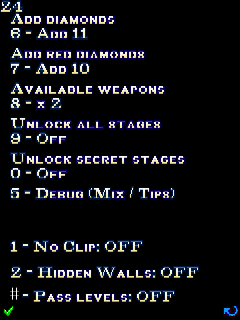
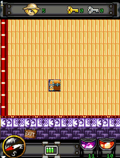
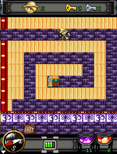
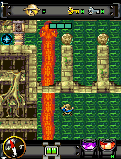

# Diamond Rush — Developer Edition

A modded fork of the decompiled Diamond Rush (Sony Ericsson S700, 240×320).

## Build

Requires a JDK (tested with OpenJDK 17), Bash, and a Java ME API JAR. On Ubuntu/Debian, install [FreeJ2ME-Plus v1.52](https://github.com/TASEmulators/freej2me-plus/releases/tag/1.52):

```sh
sudo apt install openjdk-17-jdk curl unzip
curl -fL -o /tmp/freej2me.zip https://github.com/TASEmulators/freej2me-plus/releases/download/1.52/freej2me-v1.52.zip
unzip -p /tmp/freej2me.zip freej2me.jar > /tmp/freej2me.jar
sudo install -Dm644 /tmp/freej2me.jar /usr/local/share/java/freej2me.jar
```

Build the cloned repository with:

```sh
git clone https://github.com/duyanhHSGS/Diamond-Rush.git && cd Diamond-Rush && ./build.sh
```

The script sets `CLASSPATH` to `/usr/local/share/java/freej2me.jar` (dies after bash refresh) and produces `build/Diamond-Rush-dev.jar` and `build/Diamond-Rush-dev.jad`. Update that path in `build.sh` if your Java ME library is elsewhere.

Built for modern J2ME emulators (Java 7 class format)

## Cheat menu

During gameplay, press **`# 4 7 7 2`** to open the left-aligned cheat menu.



| Key | Action |
| --- | --- |
| `1` | **No Clip:** move through obstacles, but not beyond the map border. |
| `2` | **Hidden Walls:** hide wall-like artwork over empty tiles in all three worlds. |
| `5` | **Debug:** inspect Mix text or Tips. |
| `6` / `7` | Add 50 normal diamonds / 5 red diamonds. |
| `8` | Cycle the existing weapon/blue-potion cheat. |
| `9` / `0` | Unlock all stages / secret stages. |
| `#` | **Pass Levels:** enable level skipping with `7` or `9` during gameplay. |

No Clip and Hidden Walls toggle ON/OFF, start OFF, and are not saved. The other cheats retain their original behavior.

## Hidden Walls — OFF vs ON

| OFF | ON |
| :---: | :---: |
|  |  |

## Showcase



*No Clip + Hidden Walls enabled in a boss area.*

The mode hides *visual overlays*, It also hides some non-secret decorations. See [Map Format](docs/Map%20Format.txt) for the tile rule and reverse-engineering notes.
